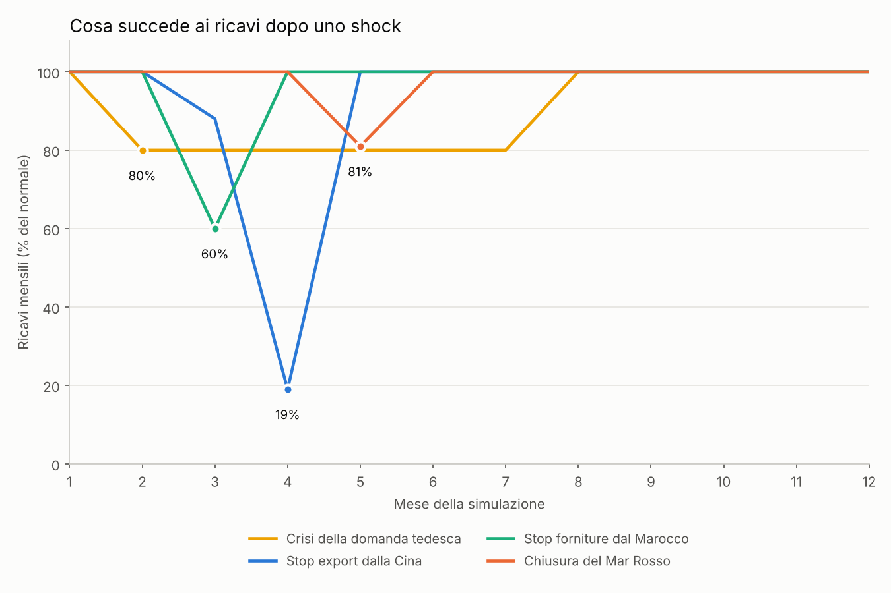

# Geopolitical Stress Test

Piccolo strumento in Python che simula **cosa succede a un'azienda quando uno shock geopolitico colpisce le sue forniture o i suoi clienti**: quanti ricavi si perdono, per quanti mesi e a causa di quale componente.

A differenza di un'analisi a punteggi, qui non si assegna un voto di rischio ai paesi: si prende uno scenario ipotetico (per esempio "la Cina blocca le esportazioni per 3 mesi") e si guarda l'effetto concreto, mese per mese.



## Lo scenario (fittizio)

Un produttore italiano di macchinari, **inventato**, con ricavi normali di 10 milioni di euro al mese.

**Cosa compra** (quota di ogni componente per paese, in `data/sources.csv`):

| Componente | Fornitori | Scorte |
|---|---|---|
| Elettronica | Cina 60%, Vietnam 25%, Germania 15% | 1 mese |
| Magneti a terre rare | Cina 90%, Germania 10% | 1,5 mesi |
| Motori e riduttori | Germania 40%, Cina 30%, Italia 30% | 1 mese |
| Cablaggi | Marocco 70%, Vietnam 30% | 1 mese |
| Carpenteria | Italia 70%, Marocco 30% | 0,5 mesi |

**A chi vende** (`data/customers.csv`): Germania 40%, Stati Uniti 25%, Francia 20%, Spagna 15%.

**Gli shock** (`data/scenarios.csv`), tutti **ipotetici** e non previsioni:

| ID | Shock | Durata |
|---|---|---|
| S1 | La Cina riduce del 90% l'export di componenti e magneti | 3 mesi |
| S2 | Chiusura del Mar Rosso: il 35% della merce da Cina e Vietnam non arriva in tempo | 4 mesi |
| S3 | Il Marocco si ferma del tutto (per esempio per scioperi nei porti) | 2 mesi |
| S4 | I clienti tedeschi dimezzano gli ordini | 6 mesi |

## Come funziona

La simulazione dura 12 mesi. Ogni mese, per ogni componente:

1. **Fornitura regolare** = somma delle quote dei paesi, ridotta dalle perdite dello shock.
2. **Fornitore alternativo**: se manca qualcosa, dopo un certo numero di mesi (il tempo per qualificarlo) entra un fornitore di riserva, fino alla sua capacità massima.
3. **Scorte**: quello che manca ancora viene coperto dal magazzino, finché ce n'è.

L'azienda produce **quanto permette il componente più scarso** (le macchine hanno bisogno di tutti i pezzi) e vende **al massimo quanto chiede il mercato**. I ricavi del mese sono il minimo tra le due cose.

## Risultati con i dati d'esempio

| Scenario | Ricavi minimi | Ricavi persi | Collo di bottiglia | Di nuovo normale |
|---|---|---|---|---|
| S4 Crisi della domanda tedesca | 80% | 12,0 M€ (10,0%) | Domanda | mese 8 |
| S1 Stop export dalla Cina | 19% | 9,3 M€ (7,8%) | Magneti | mese 5 |
| S3 Stop forniture dal Marocco | 60% | 4,0 M€ (3,3%) | Cablaggi | mese 4 |
| S2 Chiusura del Mar Rosso | 81% | 1,9 M€ (1,6%) | Elettronica | mese 6 |

Alcune letture:

- Lo stop cinese (S1) costa meno della crisi della domanda tedesca (S4), ma è il **più violento nel momento peggiore**: i ricavi scendono al 19%. Il costo complessivo e l'intensità del colpo sono due cose diverse.
- Il collo di bottiglia non è dove si pensa: nel blocco cinese a fermare l'azienda sono i **magneti**, perché hanno un solo paese fornitore e il fornitore alternativo richiede 9 mesi per essere qualificato.
- Lo shock sulla domanda (S4) dura di più ma è più dolce, e nessuna scorta può difendersene.

### E se avessimo più scorte?

```bash
python stress_test.py --extra-stock 2
```

Con 2 mesi di scorte in più per ogni componente, **gli shock sulle forniture (S1, S2, S3) non causano più alcuna perdita**, mentre quello sulla domanda (S4) resta uguale. Le scorte costano, quindi nella realtà la scelta è un compromesso: il tool serve a metterlo in numeri.

## Come usarlo

Servono Python 3.9 o superiore e `matplotlib`.

```bash
pip install -r requirements.txt
python stress_test.py
```

Opzioni:

```bash
python stress_test.py --data data --out output
python stress_test.py --extra-stock 2
```

Per analizzare un'altra azienda o altri shock basta modificare i file CSV in `data/`. Lo script controlla i dati e segnala errori come quote che non sommano 100, paesi inesistenti o valori fuori range.

File generati in `output/`: `scenario_report.csv` (una riga per scenario), `monthly_results.csv` (andamento mese per mese), `revenue_chart.png`, `dependency_report.csv` (dipendenza dai paesi fornitori), `stock_sensitivity.csv` e `stock_sensitivity.png` (perdite al crescere delle scorte).

### Due analisi in più

- **Dipendenza dai fornitori** (`dependency_report.csv`): per ogni componente, il paese principale, l'indice HHI sulle quote (da 0 a 1, dove 1 è un solo fornitore) e i **mesi scoperti** se la fornitura si fermasse del tutto, cioè tempo per qualificare un alternativo meno scorte. Descrive la struttura della filiera, indipendentemente dallo shock.
- **Sensibilità sulle scorte** (`stock_sensitivity.*`): ripete tutti gli scenari con 0, 1, ... 6 mesi di scorte in più per ogni componente e mostra dove conviene fermarsi.

## Un secondo caso: filiera della difesa

In `data_defence/` c'è un secondo scenario **inventato**: un produttore europeo di sensori e radar, con ricavi di 25 milioni di euro al mese, che dipende da materiali critici (gallio, germanio, terre rare, tungsteno) e da elettronica asiatica. I clienti sono governi europei.

```bash
python stress_test.py --data data_defence --out output_defence
```

| Scenario | Ricavi minimi | Ricavi persi | Collo di bottiglia | Di nuovo normale |
|---|---|---|---|---|
| D1 Controlli cinesi sull'export di materiali critici (6 mesi) | 32% | 52,0 M€ (17,3%) | Magneti | mese 8 |
| D2 Interruzione delle forniture da Taiwan (6 mesi) | 60% | 25,0 M€ (8,3%) | Elettronica | mese 7 |
| D3 Ritardo degli ordini governativi (UK, 4 mesi) | 82% | 18,0 M€ (6,0%) | Domanda | mese 6 |
| D4 Blocco logistico in Polonia (2 mesi) | 70% | 7,5 M€ (2,5%) | Carpenteria | mese 4 |

- I **magneti** sono il punto più fragile: 85% dalla Cina, 12 mesi per qualificare un alternativo, **10 mesi scoperti** anche con le scorte. Il blocco cinese costa più del doppio dello stop taiwanese.
- Le scorte aiutano molto: nel caso D1 le perdite scendono da 52 a 27 M€ con un mese di scorte in più e a 2 M€ con due, e a zero con tre. Contro il ritardo degli ordini (D3) non servono a nulla.
- Anche un blocco breve e lontano dai paesi "a rischio" (D4) costa 7,5 M€, perché la carpenteria ha solo mezzo mese di scorte.

Anche qui i valori sono illustrativi e gli scenari sono ipotesi, non previsioni.

## Test

```bash
python -m unittest discover -s tests
```

## Struttura

```
geopolitical-stress-test/
├── stress_test.py        # simulazione, report e grafico
├── data/                 # azienda, componenti, fornitori, clienti, scenari (CSV)
├── data_defence/         # secondo caso: filiera della difesa (stessi file)
├── output/               # risultati generati
├── output_defence/       # risultati del caso difesa
├── tests/                # test automatici
└── requirements.txt
```

## Limiti

- **Tutti i dati sono inventati.** Quote di fornitura, scorte, tempi e capacità dei fornitori alternativi sono valori illustrativi, non misurazioni di un'azienda reale.
- **I risultati dipendono molto dalle scorte.** Con scorte generose (3 mesi di magneti, per esempio) lo stop cinese di 3 mesi non avrebbe alcun effetto. Ho scelto scorte "snelle", tipiche di chi lavora *just in time*, e il tool serve proprio a vedere quanto la scelta pesi.
- Gli shock sono **ipotesi**, non previsioni, e non esprimono giudizi politici sui paesi coinvolti.
- Le scorte non si ricostituiscono dopo lo shock, quindi il modello è adatto a **un evento alla volta**.
- Si ipotizza che l'azienda venda tutta la produzione che la domanda richiede, senza magazzino di prodotti finiti, contratti con penali o prezzi che cambiano.
- Il modello non include costi aggiuntivi (trasporto più lungo, prezzi più alti), ma solo la merce che manca.
- Se più eventi colpiscono lo stesso paese nello stesso mese vale il più grave, non la somma.

## Possibili sviluppi

- Analisi di sensibilità anche sui tempi dei fornitori alternativi (oggi solo sulle scorte).
- Ricostituzione delle scorte dopo lo shock e shock in sequenza.
- Aggiungere i costi (trasporto, prezzi) oltre alla merce mancante.
- Scorte aggiuntive solo sui componenti più critici, invece che uguali per tutti.

## Licenza

MIT, vedi `LICENSE`.
